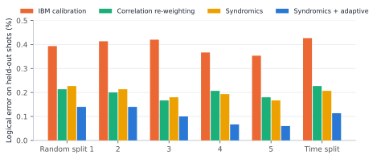
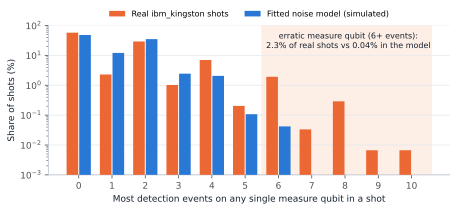
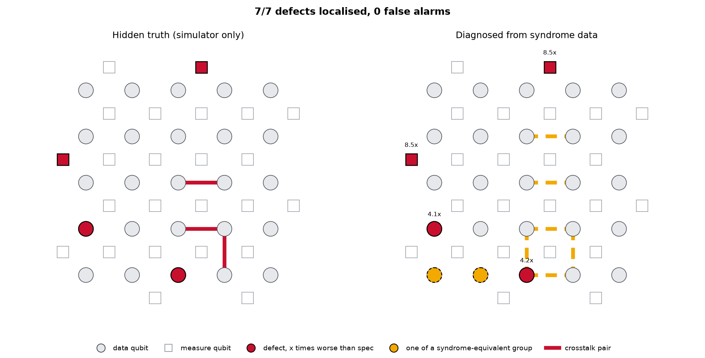
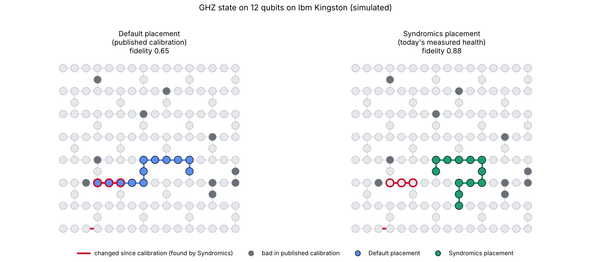

[](https://github.com/wishapples/syndromics/actions/workflows/tests.yml)

# Syndromics

**Measure a quantum chip's real noise from its own error-correction data.**

Every error-correction experiment already records a stream of detection events (syndromes).
Syndromics turns that stream into a physical noise model of the chip as it is today: which
measurements, gates and qubits are worse than their calibration says. Decoders get better
weights, and engineers see what has drifted. It needs no extra calibration experiments.

Website: [syndromics.wishapples.com](https://syndromics.wishapples.com) ·
Technical note: [docs/notes/Syndromics_Kingston_Technical_Note.pdf](docs/notes/Syndromics_Kingston_Technical_Note.pdf) ·
What's new: [CHANGELOG.md](CHANGELOG.md)

## First result on real IBM hardware (18 November 2026)

A distance-5 repetition code (9 qubits, 10 rounds, 30,000 shots) on IBM's `ibm_kingston`
(Heron r2), free Open Plan, job `dbukcjvf8rhs73bmf9l0`. Each noise model was fitted on half the
shots and tested on the other half; six splits (five random, one time-ordered); the same
PyMatching decoder throughout.

| Noise model given to the decoder | Logical error (held-out) |
|---|---|
| No decoding | 2.22% |
| Uniform (no device data) | 0.447% |
| IBM published calibration | 0.396% |
| Standard correlation re-weighting (literature) | 0.199% |
| **Syndromics** | **0.198%** (better than calibration in 6 of 6 splits) |
| Re-weighting + leakage-aware (v0.5) | 0.103% |
| **Syndromics + leakage-aware (v0.5)** | **0.103%** (better than Syndromics alone in 6 of 6 splits) |





The fit localised the main excess error at the **q128-q129** end of the line (that gate at least
4x its calibrated error; q128 has the lowest T2 on the line in IBM's data), and found mid-circuit
measure + reset 1.7-5x worse than IBM's published end-of-circuit readout.

**What drives the remaining errors.** In 2.3% of real shots one measure qubit fires six or more
detection events, near-random behaviour typical of leakage or a failed reset; a Pauli noise model
predicts 0.04% (62x fewer). These shots cause about half the logical failures. Leakage-aware
decoding (`syndromics.adaptive`) flags them per shot from their own syndrome and stops trusting
that qubit's measurements for that shot, halving the logical error again. The trick works with
any decoder model. Drift tracking over time windows (fresh fit per window, alerts confirmed in two
windows) found the components stable during this job; on simulated drift it catches a gate x4 or
measurement x3 change within one window with no false alarms.

**Stated plainly:** model-free correlation re-weighting matches our decoding gain on this small
code. What Syndromics adds is a physical model that names the component responsible, for placement,
recalibration and (we expect) reuse across circuits. Scope: one run, one 9-qubit line, one day,
bit-flip errors only.

Reproduce it in seconds, with no IBM account, from the raw shots in the
[demo kit](docs/IBM_DEMO.md) or the regression test:

```bash
pip install -e ".[ibm,dev]"
pytest tests/test_decodecheck_real.py -q
```



## Install

```bash
pip install git+https://github.com/wishapples/syndromics.git
```

Requires Python 3.10+, [Stim](https://github.com/quantumlib/Stim), NumPy, SciPy and Matplotlib.

## 30-second demo

```bash
syndromics demo --d 5 --shots 200000
```

```
9 finding(s) above threshold:
   8.5x spec  measure qubit [22] (readout)
   8.5x spec  measure qubit [6] (readout)
   4.2x spec  data qubit [49] (Z)
   4.1x spec  data qubit [34] (X)
   4.0x spec  crosstalk [38, 40] (XX) or crosstalk [49, 51] (XX)
   ...
Score against hidden truth: {"true_defects": 7, "localised": 7, "exact": 4, "false_alarms": 0}
```

The demo simulates a distance-5 chip with seven hidden defects. The diagnostics see only the
detection events, never the defect list.

## Your own data

```bash
syndromics diagnose --circuit nominal.stim --detections dets.b8 --format b8 \
                    --p 0.003 --plot chip_map.png --json findings.json
```

* `nominal.stim`: the circuit as designed, with your nominal noise model
* `dets.b8`: detection events recorded on hardware (any Stim shot format)
* `--p`: nominal physical error rate; findings are reported as multiples of it

Or from Python:

```python
from syndromics import diagnose
report = diagnose(detections, nominal_circuit, p_nominal=0.003)
print(report.summary())
```

## Real hardware

### Google Willow (public data)

Google released the detection events from its below-threshold surface-code experiment
([Zenodo 10.5281/zenodo.13273331](https://doi.org/10.5281/zenodo.13273331)). Unzip it and run:

```bash
pip install "syndromics[google]"
syndromics google /path/to/unzipped --rounds 10
```

For every patch and basis, Syndromics fits Google's own SI1000 noise model to half the shots,
then checks itself two ways that need no answer key:

* **Held-out decoding:** PyMatching decodes the other half with Google's nominal model and with
  the Syndromics-calibrated model. Real component errors make the calibrated model decode better.
* **Repeatability:** X- and Z-basis experiments on the same physical qubits are independent.
  Defects flagged in one should be flagged in the other.

### IBM Quantum (free Open Plan)

```bash
pip install "syndromics[ibm]"
syndromics ibm --backend ibm_kingston --fake      # rehearse on a simulator of the device
syndromics ibm --backend ibm_kingston             # run on hardware (uses QPU minutes)
```

This runs a repetition code on the best line of qubits it can find and fits the noise model.
For the full IBM demo (held-out decoding test, same-job reference measurements, chip health check,
A/B placement) use `syndromics-ibm-demo`; see [docs/IBM_DEMO.md](docs/IBM_DEMO.md).

See [docs/RUN_ON_REAL_DATA.md](docs/RUN_ON_REAL_DATA.md) for step-by-step instructions.

## Noise-aware placement: describe a circuit, run it on today's healthy qubits

Compilers choose qubits from the device's published calibration. That is a snapshot: qubits
drift, defects appear, readout degrades. Syndromics measures what has **changed since
calibration** and gives the corrected error rates to the compiler, so circuits avoid what is
broken *today*.

```bash
syndromics health --backend ibm_kingston                # ~7 short repetition-code runs
syndromics place "GHZ state on 12 qubits" --backend ibm_kingston \
    --health chip_health.json --plot map.png --qasm ghz12.qasm
```

Plain-English prompts are turned into circuits by built-in recipes (Bell, GHZ,
Bernstein-Vazirani, Grover, QFT, teleportation, random bits, QAOA MaxCut). Each comes with a
short explanation for students and the ideal result. Other prompts can go to a language model
if `ANTHROPIC_API_KEY` is set; it must answer in OpenQASM, which is parsed, never executed.
Requests such as "optimise routes for 50 trucks" get an honest answer: classical solvers beat
today's quantum hardware on that, so you get a teaching-size version instead.



Simulated IBM Kingston (156 qubits, Qiskit's published calibration) with hidden drift, scored by
noisy simulation of the true chip (Hellinger fidelity to the ideal output, 1 = perfect):

| Circuit | Default (published calibration) | Syndromics (today's health) | Best possible (true errors) |
|---|---|---|---|
| GHZ, 12 qubits | 0.646 | **0.877** | 0.877 |
| Grover search, 3 qubits | 0.566 | **0.981** | 0.981 |
| QFT round trip, 5 qubits | 0.762 | **0.964** | 0.964 |
| QAOA MaxCut, 6 nodes | 0.965 | **0.989** | 0.989 |
| Bernstein-Vazirani, 6 qubits | 0.950 | 0.950 | 0.950 |
| Teleportation | 0.992 | 0.992 | 0.992 |

In 20 random drift patterns (6 faults anywhere on the chip, GHZ-12) Syndromics was better in 9,
the same in 11 and worse in none; mean 0.846 → 0.878 (best possible 0.878). With no drift it
raised **zero** false alarms and made no change. Reproduce with
`python examples/noise_aware_demo.py`; full output in [docs/placement](docs/placement).

**What this does not show yet:** the drift is simulated (Pauli noise); diagnostic lines cover
115 of 156 qubits and only the couplers along those lines; placement has not yet been A/B tested
on a real chip.

## Two engines

* `syndromics.diagnose`: fingerprint method for Stim-generated rotated surface codes. Reports
  syndrome-equivalent alternatives explicitly.
* `syndromics.fit_noise`: works with **any Stim circuit** (Google's SI1000 circuits, repetition
  codes, your own). It splits the nominal noise into per-qubit, per-readout and per-gate components
  plus crosstalk candidates, and fits one scale factor each, assuming most components are as
  specified. `fit.calibrated_circuit()` returns a recalibrated circuit to decode with.

On simulated distance-5 chips (5 chips per row, 300k shots), `fit_noise` gives:

| Defect strength | Localised | False alarms |
|---|---|---|
| Strong (6× / 3p / 5×) | 35/35 | 4 (all crosstalk groups next to very strong defects) |
| Medium (3× / 1.5p / 3×) | 35/35 | 0 |
| Weak (2× / 0.75p / 2×) | 34/35 | 0 |

Decoding with the calibrated model cut logical errors from 2.46% to 1.67% on held-out shots,
the same as a decoder given the true hidden noise (1.67%).

## How it works

1. **Correlation estimates.** For every pair of detectors, the probability of an error
   mechanism that flips both is estimated from their correlation. A baseline simulated from the
   nominal model is subtracted.
2. **Fingerprints.** Each candidate fault (X/Z error on a data qubit, XX/ZZ crosstalk on a
   neighbouring pair, readout error on a measurement qubit) is injected alone into a noiseless
   copy of the circuit to get its detector fingerprint.
3. **Joint fit.** A non-negative least-squares fit makes all candidates compete to explain the
   data, so a real defect does not drag its neighbours above threshold.
4. **Honest ambiguity.** Some faults have identical fingerprints because their product is a
   stabilizer. No syndrome data can separate them, so Syndromics reports the group
   ("qubit 47 or 49") and leaves the final call to a targeted single-qubit check.

## Benchmarks

`benchmarks/sweep.py` runs 5 random distance-5 chips (7 hidden defects each) at three defect
strengths and three data budgets, with nominal error rate p = 0.4%:

| Defect strength (bad qubit / crosstalk / readout) | 50k shots | 200k shots | 1M shots | False alarms |
|---|---|---|---|---|
| Strong (6× / 3p / 5×) | 100% | 100% | 100% | 0 |
| Medium (3× / 1.5p / 3×) | 97% | 97% | 97% | 0 |
| Weak (2× / 0.75p / 2×) | 89% | 97% | 94% | 0 |

The percentages are defects localised. Estimated rates track the truth closely; for example,
a bad qubit was estimated at 1.29% extra error against 1.33% true.

## Limitations

* **One hardware run so far.** One 9-qubit line on `ibm_kingston`, one day, a repetition code.
  The Google public-data pipeline has not yet been run on the released data.
* **Linear model.** Very strong defects (about 5× spec or more) can raise a secondary crosstalk
  flag next to them.
* **Same-qubit ambiguity.** Readout error and idle error on the same measure qubit can trade off
  against each other; the qubit is identified correctly, the split between the two less so.
* **IBM gate errors** are recovered only roughly from a short repetition code; readout errors are
  recovered well.
* **Boundary crosstalk** can be underestimated when its fingerprint overlaps single-qubit faults.
* **Pauli noise model.** Leakage, non-Markovian drift and coherent errors are not modelled yet.
* **Placement coverage.** Health is measured only on the diagnostic lines (about 74% of qubits
  on Kingston and the couplers along those lines); elsewhere the published calibration is used.
  A TLS-type defect on a data qubit shows up mostly through its gates, plus a little readout.

## Roadmap

* Published results on Google Willow data and IBM hardware
* Placement validated on real IBM hardware (health check, then compare default vs Syndromics runs)
* Second set of diagnostic lines to cover the remaining couplers
* Time-resolved reports (drift tracking across a run)
* Colour codes and qLDPC codes
* Leakage detection

## About

Syndromics builds diagnostics and chip-adaptive decoding for quantum hardware teams.
We offer a free Chip Health Report on one of your datasets; contact us through
[syndromics.ai](https://syndromics.ai).

## Citation

If you use Syndromics in research, please cite it using `CITATION.cff`.

## License

MIT
